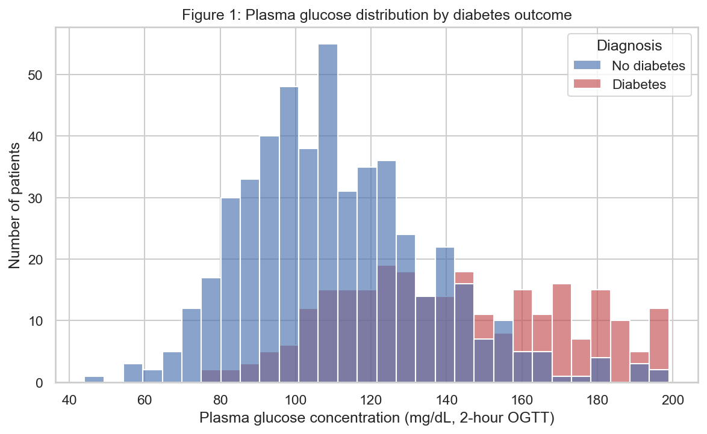
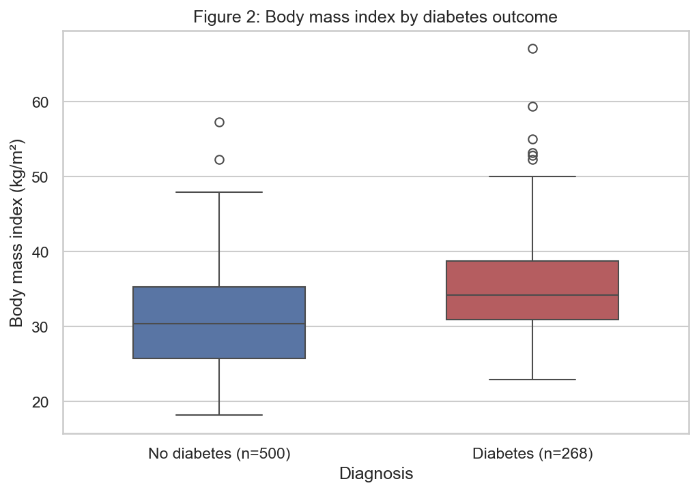
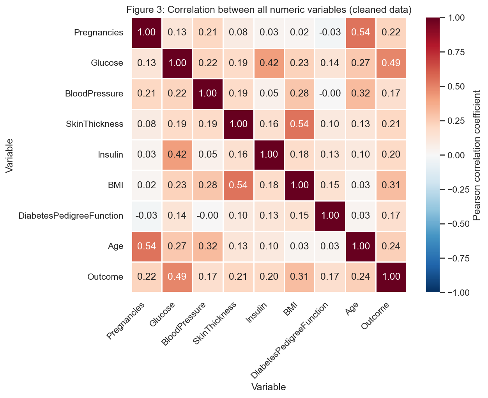

# Module Summary: A Reproducible Data Workflow on the Pima Indians Diabetes Database

Mr Intisar Shah  
MSc in Artificial Intelligence (Woolf University)  
Capstone Project 1: AI Programming Foundations Project  
30 October 2026

## Overview

This project builds a complete and reproducible data workflow in a single Jupyter notebook,
`data_workflow.ipynb`, over the Pima Indians Diabetes Database
(<https://www.kaggle.com/datasets/kumargh/pimaindiansdiabetescsv>). The notebook loads the raw CSV,
repairs the physiologically impossible zero values the file uses to encode missing measurements,
explores the cleaned data with reusable functions, and produces three labelled figures showing how
plasma glucose, body mass index and the remaining variables relate to a diabetes diagnosis. No
machine learning model is trained; the deliverable is the documented foundation that later modelling
work would sit on.

## Dataset Description

The dataset holds 768 diagnostic records collected by the National Institute of Diabetes and
Digestive and Kidney Diseases and first published with the ADAP learning algorithm study by Smith et
al. (1988). Every patient is a woman of Pima heritage aged 21 or over, and the nine columns are
eight diagnostic measurements plus a binary `Outcome` flag where 1 means a diabetes diagnosis. The
eight measurements are `Pregnancies`, `Glucose` (plasma glucose two hours into an oral glucose
tolerance test), `BloodPressure` (diastolic, mm Hg), `SkinThickness` (triceps fold, mm), `Insulin`
(two-hour serum insulin, mu U/ml), `BMI` (kg/m²), `DiabetesPedigreeFunction` (a family history score)
and `Age` (21 to 81 years). I focused on glucose, BMI and age, which turned out to be the three
variables most strongly associated with the diagnosis, and on insulin and skin thickness, which
turned out to be the two most damaged by missing data. The classes are uneven: 500 patients (65.1%)
have no diagnosis against 268 (34.9%) who do. The file is distributed under a CC0 public domain
dedication.

## Workflow Description

The notebook runs in seven numbered sections, in the order a reader would need them.

Section 1 imports NumPy, pandas, Matplotlib and seaborn and prints their versions, so anyone
rerunning the notebook can see the environment it was written in. Section 2 ingests `diabetes.csv`
with `pd.read_csv` using a relative path and prints the first rows, the shape and the column types to
confirm the file arrived intact. Section 3 defines three cleaning functions and applies them:
`replace_invalid_zeros` converts the impossible zeros to NaN, `check_duplicates` reports and would
remove repeated rows, and `impute_missing_with_median` fills the gaps. Section 4 defines three
exploratory functions: `summarise_data` for distributions, missing counts and class balance,
`group_by_outcome` for mean values per diagnosis group, and `correlation_check` for the Pearson
correlation of every variable with the target. Section 5 produces the three figures and saves each
one to `figures/` as a PNG. Section 6 wraps the whole pipeline in `run_workflow`, reruns it from the
raw file and asserts that the result matches the data built step by step, which demonstrates that the
workflow runs end to end on a fresh copy of the file. Section 7 closes with the written
summary and interpretation. Every function carries a docstring stating what it does, what it takes
and what it returns, which is the documentation habit Wilson et al. (2017) recommend for code that
anyone other than the author will read.

## Key Decisions and Assumptions

**Treating zeros as missing data.** The single most consequential decision was to stop trusting the
file. Pandas reports zero null values across all 768 rows, yet a plasma glucose, diastolic blood
pressure, triceps fold thickness, serum insulin or BMI of exactly zero is not possible in a living
patient. Counting the zeros showed how much was hidden: 374 in `Insulin` (48.7% of rows), 227 in
`SkinThickness` (29.6%), 35 in `BloodPressure` (4.6%), 11 in `BMI` (1.4%) and 5 in `Glucose` (0.7%).
`replace_invalid_zeros` converts those to NaN so pandas can see them. Zeros in `Pregnancies` are real
and were left alone, since 111 patients having never been pregnant is an ordinary finding. The cost
of skipping this step is visible in the comparison table in section 3: the raw mean insulin level is
79.8 mu U/ml against 140.7 after cleaning, because 374 fictional zeros were being averaged in as
measurements. Sterne et al. (2009) describe exactly this failure mode, where missing values coded as
real ones bias every estimate computed from them.

**Choosing median imputation over deleting rows.** Dropping incomplete rows is the obvious
alternative and the wrong one here. With 48.7% of insulin values missing, listwise deletion would
discard roughly half the dataset and leave a sample biased toward the patients who happened to
receive a full panel of tests, which is the selection problem Sterne et al. (2009) warn against.
`impute_missing_with_median` instead fills each gap with the median of the observed values in the
same column. The median was chosen over the mean because all five variables are right skewed and
carry high outliers, which drag a mean upward and would place the filled values away from the typical
patient. This keeps all 768 rows at a real cost, discussed under Responsible Practice below.

**Checking for duplicates.** `check_duplicates` reports repeated rows before any analysis runs. The
file has none, but a duplicate patient record would be counted twice in every statistic and plot that
follows, and confirming its absence is cheaper than discovering it later. Wilson et al. (2017) make
the general case for these small validation steps as part of routine data work.

**Keeping the raw data immutable.** Every cleaning function returns a copy rather than editing in
place, so `df_raw` survives untouched beside the cleaned frame and the two can be compared directly.
Treating the raw file as read only, and deriving everything else from it through recorded steps, is a
core reproducibility rule in both Sandve et al. (2013) and Wilson et al. (2017).

**What each figure was designed to show.** Figure 1 is a histogram of plasma glucose split by
diagnosis, chosen to test whether the strongest single correlate of the outcome actually separates
the two groups and where along the glucose scale that separation begins. Figure 2 is a boxplot of BMI
by diagnosis, chosen over a second histogram because it puts the medians, the interquartile ranges
and the outliers of both groups side by side, which is what a two-group comparison needs. Figure 3 is
a correlation heatmap of all nine numeric variables, which shows the whole correlation structure at
once: both which variables track the outcome and which track each other closely enough to carry
overlapping information. Each figure has a title, labelled axes with units, and a legend or tick
labels naming the two groups, following the principle in Waskom (2021) that a statistical graphic
should carry the information needed to read it without the surrounding code.

## Results and Interpretation

Glucose is the clearest signal in the data. Figure 1 shows the two distributions overlapping but
sitting in different places: 346 of the 500 patients without a diagnosis fall below 120 mg/dL, while
above 140 mg/dL the diagnosed group outnumbers them by 132 to 60. The group means follow the same
pattern at 142.1 mg/dL for diagnosed patients against 110.7 for the rest, and glucose has the highest
correlation with the outcome in the file at 0.49.

Body mass index separates the groups in the same direction but less sharply. Figure 2 puts the median
BMI of diagnosed patients at 34.3 against 30.4 for the rest, with the whole box shifted upward and the
interquartile range running from 30.9 to 38.8 against 25.8 to 35.3. Both groups sit in the overweight
to obese range on the standard BMI scale and the boxes overlap across most of their span, so BMI
shifts the odds without splitting the sample. Both groups also carry high outliers, reaching 57.3
in the undiagnosed group and 67.1 in the diagnosed one.

Figure 3 puts those two findings in context and adds a third. Reading the `Outcome` row, glucose
(0.49), BMI (0.31) and age (0.24) are the strongest links to a diagnosis, with the remaining
variables between 0.17 and 0.22. Away from the target, three pairs stand out: age with pregnancies
(0.54), skin thickness with BMI (0.54), and insulin with glucose (0.42). The first two are expected,
since older patients in this cohort have had more pregnancies and both skin fold thickness and BMI
measure body fat. Those pairs carry overlapping information, so a later model would gain little from
treating them as independent inputs.

The group comparison in section 4 adds one result the figures do not show. Every variable is higher
on average among diagnosed patients, and the widest proportional gap is in `Pregnancies` at 47.6%,
ahead of insulin at 28.9% and glucose at 28.4%. I read the pregnancy gap as a reflection of age and
of the gestational diabetes history specific to this cohort rather than as a general risk factor,
since age and pregnancies correlate at 0.54 in the same matrix.

Taken together, the analysis says that diabetes status in this cohort tracks plasma glucose most
closely, then BMI and age, and that no single measurement comes close to determining the outcome on
its own. The distributions overlap heavily in every comparison, so the signal is genuinely
multivariate, and that was the most useful surprise in the project: the correlations are real but
modest, which is the expected shape for clinical screening data and a warning against reading any one
variable as diagnostic. Three assumptions carry through all of it. I assumed that every zero in the
five affected columns is an unrecorded measurement rather than some other recording error, which the
clinical impossibility of the values supports but does not prove. I assumed that median imputation is
an acceptable substitute for those measurements, which is defensible for glucose, blood pressure and
BMI at under 5% missing and much weaker for insulin at 48.7%. And I assumed that patients with and
without a diagnosis were measured the same way, which the data cannot confirm. The limitations follow
from the cohort and the file itself: all 768 patients are women of Pima heritage aged 21 and over,
the class split is 65/35, and `DiabetesPedigreeFunction` is documented only as a family history score
without the formula behind it, so its weak correlation with the outcome (0.17) cannot be interpreted
with any confidence.

## Responsible Practice (Bias and Data Quality)

The imputation step is where this workflow could mislead someone. Filling 374 insulin values and 227
skin thickness values with a single number each puts an artificial spike at the median of both
distributions, shrinks their variance, and pulls any correlation involving them toward zero. The
insulin correlation of 0.20 with the outcome should therefore be read as a floor rather than an
estimate, and no one should quote the insulin standard deviation from the cleaned data as if it
described the cohort. Sterne et al. (2009) make the stronger point that single imputation understates
uncertainty because the filled values are treated as though they were observed, and multiple
imputation exists precisely to carry that uncertainty forward. A second risk sits underneath it: if
insulin tests were ordered more often for patients who already looked unwell, then the missingness
itself carries information, the data are not missing at random, and median filling erases that
pattern. The file carries no information about who was tested or why, so this
cannot be checked from the data alone.

Three things in the notebook keep that risk visible to a reader. The cleaning functions print the
missing count and percentage per column before and after, so the scale of the imputation stays
visible instead of disappearing into a clean table. The raw frame is kept beside the cleaned one and
compared directly, which is what makes the insulin shift from 79.8 to 140.7 mu U/ml legible at all.
And section 7 states the compression as a limitation in the notebook itself. If
this work continued, the next steps would be multiple imputation for insulin and skin thickness so
the uncertainty propagates into any downstream estimate, a sensitivity check comparing conclusions
drawn with and without those two columns, and a missingness indicator column to test whether being
untested predicts the outcome by itself.

The cohort is the other bias, and it is one that cleaning cannot touch. Every record describes a
woman of Pima heritage aged 21 or over, a population with an unusually high diabetes prevalence, so
nothing here transfers to men, to younger patients, or to other ethnic groups, and a threshold tuned
on this data would misclassify elsewhere. Obermeyer et al. (2019) show how a health algorithm trained
on data that encoded one population's circumstances went on to systematically under-serve Black
patients, which is the concrete form this kind of narrow training population takes once a model is
deployed. Recording the population, the collection method and the known gaps alongside the data, as
Gebru et al. (2021) propose with datasheets, is the practice that keeps a limitation like this
attached to the dataset as it travels between the file and the analysis. In this project the
constraint is stated in the notebook introduction, in section 7, and here, so a reader meets it
before any result.

## Reproducibility

Anyone can rerun this work from the repository. The dependencies are pinned in `requirements.txt` and
installed with `pip install -r requirements.txt`, which fixes the versions of NumPy, pandas,
Matplotlib, seaborn and the notebook server to the ones the analysis was written against. That file
was generated with `pip freeze` and then reduced to the direct dependencies, because a full freeze of
this Anaconda environment pins 370 packages to local conda build paths of the form
`package @ file:///C:/...` that pip cannot install from on another machine. A README gives the install
command and the run instructions. The notebook itself loads `diabetes.csv` from a relative path, seeds
NumPy, prints the library versions it ran under, and was executed from a restarted kernel from top to
bottom with no errors before submission, so the stored outputs match the code that produced them.
Danchev (2022) treats exactly this combination, a notebook that runs top to bottom in a declared
environment, as the baseline for reproducible data science teaching, and the layout here follows that
model: the raw CSV ships with the code, every transformation is a recorded function call, and the
figures are regenerated each time the notebook runs.

Version control carries the history. The project is a Git repository named
`ai-programming-foundations-project` with commits made at each stage of the work, from the dataset and
the notebook through the figures, the README and this report, so the sequence of changes can be read
from `git log`. Development happened on a `dev` branch and was merged into `main` at the end, which
keeps the working branch separate from the published state and leaves the repository with two
branches. Wilson et al. (2017) describe this as the minimum version control discipline for
small-project work, and Sandve et al. (2013) tie the same practice to their rule that every result
should be traceable to the exact state of the code that produced it.

## Future Integration Reflections

If this data were used to train a machine learning model, the biggest change would be where the
cleaning happens: the median would have to be computed on the training split alone and then applied to
the validation and test splits, because fitting it on the full dataset leaks information across the
split and inflates the reported score, which is the most common form of the leakage Kapoor and
Narayanan (2023) found across published machine learning science. The 65/35 class imbalance would also
have to be handled explicitly, through class weights or a resampling method such as SMOTE (Chawla et
al., 2002), and the metric would move from accuracy to recall and AUC, since a screening model that
misses diabetic patients fails in the way that matters most. Before training a neural network on these
nine columns I would standardise the features, because they span wildly different scales from a
pedigree score near 0.5 to insulin readings in the hundreds, and unscaled inputs make gradient descent
converge slowly and unevenly (LeCun et al., 2012); I would also reserve a held-out test set before any
preprocessing, reconsider median imputation in favour of multiple imputation given how much of the
insulin column is filled, and check that 768 rows can support the capacity of the network I intend to
train. Agentic automation would help most with the repetitive and checkable parts of this workflow:
rerunning the notebook when the data file changes, regenerating the figures, flagging new impossible
values or schema drift, and keeping the environment file in step with the imports. It would be risky
at the decision points, because the choice to read a zero as missing data, to impute rather than drop,
and to name the cohort as a limitation are judgements about what the data means, and an agent that
made them silently would produce a tidy dataset whose distortions nobody had agreed to. The division I
would keep is that an agent can execute and verify the workflow, while a person decides what counts as
a defensible transformation.

## Sources and Citations

Chawla, N. V., Bowyer, K. W., Hall, L. O., & Kegelmeyer, W. P. (2002). SMOTE: Synthetic minority
over-sampling technique. *Journal of Artificial Intelligence Research, 16*, 321-357.
<https://doi.org/10.1613/jair.953>

Danchev, V. (2022). Reproducible data science with Python: An open learning resource. *Journal of
Open Source Education, 5*(56), 156. <https://doi.org/10.21105/jose.00156>

Gebru, T., Morgenstern, J., Vecchione, B., Vaughan, J. W., Wallach, H., Daumé, H., III, & Crawford, K.
(2021). Datasheets for datasets. *Communications of the ACM, 64*(12), 86-92.
<https://doi.org/10.1145/3458723>

Kapoor, S., & Narayanan, A. (2023). Leakage and the reproducibility crisis in machine-learning-based
science. *Patterns, 4*(9), Article 100804. <https://doi.org/10.1016/j.patter.2023.100804>

LeCun, Y. A., Bottou, L., Orr, G. B., & Müller, K.-R. (2012). Efficient BackProp. In G. Montavon, G. B.
Orr, & K.-R. Müller (Eds.), *Neural networks: Tricks of the trade* (2nd ed., pp. 9-48). Springer.
<https://doi.org/10.1007/978-3-642-35289-8_3>

McKinney, W. (2010). Data structures for statistical computing in Python. In S. van der Walt & J.
Millman (Eds.), *Proceedings of the 9th Python in Science Conference* (pp. 56-61).
<https://doi.org/10.25080/Majora-92bf1922-00a>

Obermeyer, Z., Powers, B., Vogeli, C., & Mullainathan, S. (2019). Dissecting racial bias in an
algorithm used to manage the health of populations. *Science, 366*(6464), 447-453.
<https://doi.org/10.1126/science.aax2342>

Sandve, G. K., Nekrutenko, A., Taylor, J., & Hovig, E. (2013). Ten simple rules for reproducible
computational research. *PLOS Computational Biology, 9*(10), Article e1003285.
<https://doi.org/10.1371/journal.pcbi.1003285>

Smith, J. W., Everhart, J. E., Dickson, W. C., Knowler, W. C., & Johannes, R. S. (1988). Using the
ADAP learning algorithm to forecast the onset of diabetes mellitus. *Proceedings of the Annual
Symposium on Computer Application in Medical Care*, 261-265.
<https://pmc.ncbi.nlm.nih.gov/articles/PMC2245318/>

Sterne, J. A. C., White, I. R., Carlin, J. B., Spratt, M., Royston, P., Kenward, M. G., Wood, A. M., &
Carpenter, J. R. (2009). Multiple imputation for missing data in epidemiological and clinical
research: Potential and pitfalls. *BMJ, 338*, Article b2393. <https://doi.org/10.1136/bmj.b2393>

Waskom, M. L. (2021). seaborn: Statistical data visualization. *Journal of Open Source Software,
6*(60), Article 3021. <https://doi.org/10.21105/joss.03021>

Wilson, G., Bryan, J., Cranston, K., Kitzes, J., Nederbragt, L., & Teal, T. K. (2017). Good enough
practices in scientific computing. *PLOS Computational Biology, 13*(6), Article e1005510.
<https://doi.org/10.1371/journal.pcbi.1005510>

### Dataset

Kumar, G. (n.d.). *Pima Indians Diabetes Database* [Data set]. Kaggle.
<https://www.kaggle.com/datasets/kumargh/pimaindiansdiabetescsv> (Original data from the National
Institute of Diabetes and Digestive and Kidney Diseases, via Smith et al., 1988)
